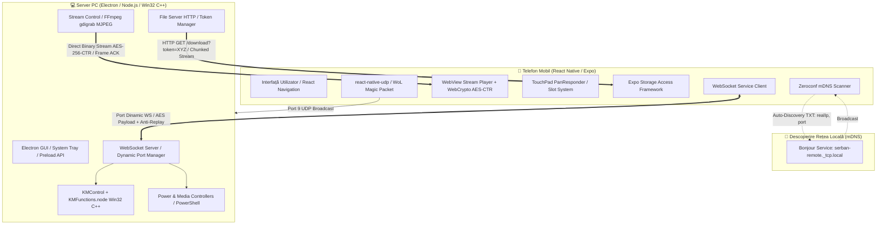

# 🚀 Antigravity Remote Control — Desktop Server & Mobile Client

Un sistem complet de control de la distanță (**Remote Desktop & Control Suite**) pentru PC (Windows), compus dintr-un **Server Desktop (Node.js / Electron / C++ Win32 Addon)** și o **Aplicație Mobilă (React Native / Expo)**. Proiectul permite partajarea ecranului în timp real cu latență minimă, control complet de mouse și tastatură cu gesturi avansate multi-touch, explorare și descărcare securizată de fișiere, control media, managementul stării de alimentare (inclusiv Wake-on-LAN) și descoperire automată prin mDNS, totul protejat prin criptare simetrică **AES-256**.

---

## 📑 Cuprins
1. [Arhitectura Generală a Sistemului](#-arhitectura-generală-a-sistemului)
2. [Componenta 1: Serverul Desktop (`_nodejs`)](#-componenta-1-serverul-desktop-_nodejs)
   - [Tehnologii & Dependințe](#tehnologii--dependințe-server)
   - [Interfața Grafică (Electron GUI & System Tray)](#interfața-grafică-electron-gui--system-tray)
   - [Miezul WebSocket & Managementul Portului](#miezul-websocket--managementul-portului)
   - [Modulul C++ Nativity (`KMFunctions.cpp`)](#modulul-c-nativity-kmfunctionscpp)
   - [Screen Streaming Engine (FFmpeg & Flow Control)](#screen-streaming-engine-ffmpeg--flow-control)
   - [File Server & Sistem de Token-uri de Unică Folosință](#file-server--sistem-de-token-uri-de-unică-folosință)
   - [Control Sistem & Media](#control-sistem--media)
3. [Componenta 2: Aplicația Mobilă (`react-native-app`)](#-componenta-2-aplicația-mobilă-react-native-app)
   - [Tehnologii & Dependințe](#tehnologii--dependințe-mobil)
   - [Design System & Personalizare (Theme & Language Context)](#design-system--personalizare)
   - [Descoperire Automată prin mDNS (`react-native-zeroconf`)](#descoperire-automată-prin-mdns)
   - [Screen Share cu Hardware-Accelerated WebCrypto](#screen-share-cu-hardware-accelerated-webcrypto)
   - [TouchPad cu Sistem de Sloturi Multi-Touch & Tastatură Virtuală](#touchpad--tastatură-virtuală)
   - [Wake-on-LAN (UDP Magic Packet) & Power Management](#wake-on-lan--power-management)
   - [Explorator de Fișiere & Descărcare Asincronă cu SAF](#explorator-de-fișiere--descărcare-asincronă-cu-saf)
4. [Securitate & Protocoale de Comunicație](#-securitate--protocoale-de-comunicație)
5. [Structura Completă a Fișierelor](#-structura-completă-a-fișierelor)
6. [Instalare & Rulare](#-instalare--rulare)
   - [Cerințe Preliminare](#cerințe-preliminare)
   - [Pornire Server Desktop](#1-pornire-server-desktop)
   - [Pornire Aplicație Mobilă](#2-pornire-aplicație-mobilă)
7. [Depanare & Bune Practici](#-depanare--bune-practici)

---

## 🏛️ Arhitectura Generală a Sistemului

Arhitectura este distribuită Client-Server pe rețeaua locală (LAN / Wi-Fi), utilizând multiple canale de comunicare optimizate pentru fiecare tip de transfer:



---

## 💻 Componenta 1: Serverul Desktop (`_nodejs`)

### Tehnologii & Dependințe (Server)
- **Electron (v43.0.0)**: Asigură rularea aplicației ca software nativ de desktop cu tray system și interfață izolată.
- **Node.js (v20+) & Node-GYP**: Suport pentru compilarea de module C++ native (`.node`).
- **ws (v8.18.0)**: Server WebSocket rapid pentru comenzi și transferul fluxului video.
- **bonjour-service (v1.4.2)**: Publică serverul în rețeaua mDNS locală fără a necesita configurare manuală de IP.
- **Crypto-JS & Node Crypto**: Criptare AES-256 pentru pachetele de date și fluxul video binar.
- **@ffmpeg-installer/ffmpeg & fluent-ffmpeg**: Captură video desktop de înaltă performanță.
- **robotjs & Win32 C++ API**: Emulare de taste și comenzi de mouse la nivel de nucleu Windows.

---

### Interfața Grafică (Electron GUI & System Tray)
- **Single Instance Lock**: Aplicația împiedică rularea de instanțe multiple; la a doua deschidere, aduce fereastra existentă în prim-plan.
- **System Tray Lifecycle**: La apăsarea butonului de închidere `(X)`, fereastra se ascunde în System Tray (lângă ceasul Windows). Dublu-click pe iconiță redeschide setările.
- **Meniu Contextual Tray**: Afișează statusul în timp real (`Status: Online (Port: 54321)` sau `Offline`), opțiune de deschidere a panoului de setări și buton de oprire completă a serverului.
- **Pornire Automată (Auto-Startup)**: Opțiune configurabilă pentru pornirea aplicației la inițializarea sistemului Windows (`app.setLoginItemSettings`).
- **Pornire Silențioasă (Silent Start)**: Dacă o parolă este deja salvată, serverul pornește invizibil direct în Tray fără a deranja utilizatorul.
- **Teme & Personalizare**:
  - Suport Dark Mode / Light Mode complet.
  - Paletă de culori de accent (Albastru, Verde, Roșu, Portocaliu, Mov, Roz).
  - Suport multilingv integrat (13 limbi disponibile: Română, Engleză, Franceză, Germană, Spaniolă, Italiană, Portugheză, Chineză, Japoneză, Coreeană, Rusă, Arabă, Hindi).
  - Dropdown custom animat și sistem de alerte grafice conforme cu tema.
- **Indicator de Conexiune Activă**: Punct de stare dinamic (Verde / Roșu) ce semnalizează dacă un telefon este autentificat și conectat în acel moment.

---

### Miezul WebSocket & Managementul Portului
Fișierul central este [`server/websocket.js`](file:///d:/_Proiecte/_atestat/_nodejs/server/websocket.js):
- **Alocare Hibridă de Port (`server/PortManager.js`)**:
  - **Modul Automat**: Pornește cu `listen(0)`, permițând sistemului de operare Windows să aloce primul port liber dinamic. Portul generat este salvat în `%APPDATA%\AntigravityRemote\config.json`. La următoarele rulări, serverul încearcă să refolosească același port pentru a nu necesita reconectare pe telefon.
  - **Tratare Conflicte (EADDRINUSE)**: Dacă portul salvat este ocupat de alt program, serverul generează automat un alt port liber (fallback pe portul 0) fără a bloca aplicația.
  - **Modul Manual**: Permite utilizatorului să definească un port fix între 1024 și 65535.
- **Filtrare Avansată a Interfețelor Virtuale (`getPhysicalLanIp`)**:
  - Scanează toate interfețele de rețea ale plăcilor de bază (`os.networkInterfaces()`).
  - Exclude explicit adaptoarele software: VirtualBox (`192.168.56.x`), VMware, Hyper-V, vEthernet, WSL, plăci APIPA link-local (`169.254.x.x`) și hotspot-uri Windows ICS (`192.168.137.x`).
  - Extrage doar adresa IPv4 fizică conectată la router și o publică în câmpul `txt.realIp` al pachetului mDNS.
- **Securitate la Autentificare & Anti-Replay**:
  - Conexiunea nouă are o fereastră de timeout de **5 secunde** pentru handshake.
  - Clientul trimite pachetul `AUTH / PING` criptat AES cu parola serverului. Dacă parola este incorectă sau decriptarea eșuează, serverul închide conexiunea imediat cu codul `4001 (Unauthorized)`.
  - **Anti-Replay Attack**: Fiecare pachet include un `timestamp`. Dacă diferența față de ceasul serverului depășește **2000 ms (2 secunde)**, comanda este ignorată.
- **Politica de Client Unic (`handleNewConnection`)**:
  - Dacă un alt dispozitiv încearcă să preia controlul în timp ce există deja un client conectat, serverul trimite mesajul `SYSTEM: CONNECTION_REJECTED` (`client_already_connected`) și refuză noua conexiune.

---

### Modulul C++ Nativity (`KMFunctions.cpp`)
Pentru viteză maximă și eliminarea oricărui lag la mișcarea mouse-ului, operațiile critice sunt compilate ca modul nativ Node.js C++ cu legături Win32 API directe:
- **`SetCursorPosition(x, y)`**: Utilizează `GetCursorPos()` și `SetCursorPos()` cu delta relativă.
- **`Scroll(x, y)`**: Apelează `mouse_event(MOUSEEVENTF_WHEEL / MOUSEEVENTF_HWHEEL)`.
- **`Zoom(amount)`**: Simulează tasta `VK_CONTROL` apăsată combinată cu scroll-ul rotiței de mouse.
- **`MinimizeAllWindows()` / `RestoreAllWindows()`**: Apelează funcția Win32 `ShowWindow(GetDesktopWindow(), SW_MINIMIZE / SW_RESTORE)` pentru afișarea rapidă a Desktop-ului.
- **`LeftClick()` / `RightClick()`**: Generează evenimente native `MOUSEEVENTF_LEFTDOWN` / `LEFTUP`.
- **`SendKeyPress(asciiCode)`**: Folosește funcția Win32 `SendInput(INPUT_KEYBOARD)` transmițând caractere UNICODE (`KEYEVENTF_UNICODE`) sau scan-coduri hardware dedicate pentru Enter (`0x1C`) și Backspace (`0x0E`).

---

### Screen Streaming Engine (FFmpeg & Flow Control)
Implementat în [`Control/StreamControl.js`](file:///d:/_Proiecte/_atestat/_nodejs/Control/StreamControl.js):
- **Captură Ecran**: Pornește un proces FFmpeg independent folosind driverul `gdigrab` cu randarea hardware a cursorului (`-draw_mouse 1`, `-framerate 30`, `-vsync cfr`, `-c:v mjpeg`, `-q:v 5`).
- **Procesare Buffer & Tăiere Cadre JPEG**:
  - Chunk-urile din `stdout` sunt concatenate într-un buffer continuu.
  - Se identifică delimitatorii standard JPEG: Start of Image (`0xFF, 0xD8`) și End of Image (`0xFF, 0xD9`).
  - Se filtrează cadrele incomplete sau corupte (sub 5 KB).
- **Control al Fluxului (Flow Control ACK)**:
  - Serverul transmite un cadru către client doar dacă variabila `isClientReady` este `true`.
  - Când clientul termină de decriptat și randat cadrul pe ecranul telefonului, trimite un semnal ultra-ușor necriptat `FRAME_ACK`.
  - **Rezultat**: Se elimină complet cozile de așteptare din memorie (buffer bloat), iar latența se menține la sub 40-50 ms chiar și pe rețele Wi-Fi congestionate.
- **Criptare Video pe Canal Separat**:
  - Fiecare cadru JPEG binar este criptat pe loc cu **AES-256-CTR** utilizând un Vector de Inițializare (**IV**) aleatoriu de 16 octeți generat per cadru (`crypto.randomBytes(16)`).
  - Pachetul binar trimis are structura `[16 Bytes IV] + [Encrypted JPEG Data]`.

---

### File Server & Sistem de Token-uri de Unică Folosință
Implementat în [`server/FileServer.js`](file:///d:/_Proiecte/_atestat/_nodejs/server/FileServer.js) și [`server/TokenManager.js`](file:///d:/_Proiecte/_atestat/_nodejs/server/TokenManager.js):
- **Listare Partiții & Directoare (`Control/File/getFiles.js`)**:
  - Detectează automat toate literele partițiilor active din Windows (`C:`, `D:`, etc.) folosind comanda PowerShell `Get-PSDrive -PSProvider FileSystem`.
  - Navighează asincron în directoare cu `fs.promises.readdir` cu `withFileTypes: true`, sortând automat folderele înaintea fișierelor.
- **Sistem de Tichete de Descărcare (Single-Use Token)**:
  - Când utilizatorul dorește să descarce un fișier, serverul generează un token criptografic unic de 16 octeți hexazecimal.
  - Token-ul este valabil **maximum 30 de secunde** și este distrus din memorie la prima consumare (`TokenManager.consumeToken`). Niciun fișier nu poate fi descărcat fără un token valid.
- **Streaming Criptat HTTP (Zero Memory Bloat)**:
  - Serverul HTTP rulează pe un port dinamic dedicat.
  - Endpoint-ul `/download?token=XYZ` deschide un `fs.createReadStream(filePath)`.
  - Datele sunt trimise printr-un pipe direct: `Disc -> Cipher AES-256-CTR -> Răspuns HTTP`. Chiar și fișierele de mai mulți gigaocteți sunt transmise fără a încărca memoria RAM a PC-ului.

---

### Control Sistem & Media
- **Power Management ([`Control/PowerControl.js`](file:///d:/_Proiecte/_atestat/_nodejs/Control/PowerControl.js))**: Execută comenzi native Windows prin `node-cmd` pentru:
  - `SHUTDOWN` (`shutdown -s`)
  - `RESTART` (`shutdown -r`)
  - `HIBERNATE` (`shutdown /h`)
  - `SLEEP` (`rundll32.exe powrprof.dll,SetSuspendState 0,1,0`)
  - `LOGOUT` (`shutdown /l`)
  - `LOCK` (`rundll32.exe user32.dll,LockWorkStation`)
- **Media Control ([`Control/MediaControl.js`](file:///d:/_Proiecte/_atestat/_nodejs/Control/MediaControl.js))**: Trimite taste virtuale multimedia prin interop PowerShell / C# (`keybd_event`):
  - `VOLUME_UP` / `VOLUME_DOWN` (tastele virtuale 175 / 174)
  - `PLAY_PAUSE` (`VK_MEDIA_PLAY_PAUSE` 0xB3)
  - `PREVIOUS` (`VK_MEDIA_PREV_TRACK` 0xB1)
  - `NEXT` (`VK_MEDIA_NEXT_TRACK` 0xB0)

---

## 📱 Componenta 2: Aplicația Mobilă (`react-native-app`)

### Tehnologii & Dependințe (Mobil)
- **React Native (0.81.5) & Expo SDK (v54)**: Baza aplicației mobile cross-platform.
- **React Navigation (v6)**: Navigare bazată pe stivă (`NativeStackNavigator`).
- **react-native-zeroconf**: Monitorizare și rezoluție mDNS pe Android prin `NsdManager`.
- **react-native-webview**: Redă fluxul video desktop cu suport pentru WebCrypto nativ.
- **react-native-udp**: Trimitere pachete binare UDP pe broadcast pentru funcția Wake-on-LAN.
- **expo-file-system (Modern File API + Storage Access Framework)**: Gestiune stocare locală și salvare fișiere în orice folder din sistemul Android.
- **crypto-js**: Criptare/decriptare AES a mesajelor JSON pe mobil.

---

### Design System & Personalizare
- **Stil Vizual Modern (Glassmorphism & Gradients)**: Carduri cu transparență blurată, borduri subtile și accente dinamice cu `expo-linear-gradient`.
- **ThemeContext**:
  - Mod Întunecat (Dark Mode: fundal `#0A0B10`) / Mod Luminos (Light Mode: fundal `#F2F2F7`).
  - 6 Culori de temă selectabile (Albastru, Mov, Verde, Roșu, Galben, Portocaliu).
  - Reglaje de sensibilitate pentru TouchPad (Cursor, Scroll, Zoom cu reglaj pas cu pas de la `0.1x` la `3.0x`).
  - Persistență automată în `settings_config.json`.
- **LanguageContext & Sistem Multilingv**:
  - Dicționar complet în `translations.js` pentru **23 de limbi**: Română, Engleză, Arabă, Bengali, Chineză, Olandeză, Franceză, Germană, Hindi, Indoneziană, Italiană, Japoneză, Coreeană, Persană, Poloneză, Portugheză, Rusă, Spaniolă, Tamil, Thailandeză, Turcă, Ucraineană, Vietnameză.
  - Toate alertele, etichetele, butoanele și ghidurile sunt traduse dinamic.
- **CustomAlert (Coada FIFO de Alerte)**:
  - Înlocuiește alertele native Android/iOS cu o componentă grafică modală conformă cu tema aleasă.
  - Include un sistem intern de coadă (**Queue FIFO**) pentru a asigura afișarea cronologică a tuturor mesajelor importante fără suprapuneri sau dispariții premature.

---

### Descoperire Automată prin mDNS (`LocalComputersScreen.js`)
- **Scanare Locală Continuă**:
  - Solicită automat permisiunile native pe Android (`NEARBY_WIFI_DEVICES` pentru Android 13+ și `ACCESS_FINE_LOCATION`).
  - Efectuează o scanare continuă timp de 12 secunde căutând serviciul `serban-remote._tcp.local.`.
- **Filtrare Strictă a IP-urilor**:
  - Dă prioritate adresei IP fizice trimise de server în câmpul `service.txt.realIp`.
  - Fallback inteligent: filtrează adresele IPv6, loopback (`127.0.0.1`), adresele link-local APIPA (`169.254.x.x`), rețelele interne VirtualBox (`192.168.56.x`) și hotspot-urile Windows (`192.168.137.x`).
  - La găsirea serverului, scanarea se oprește instant, iar dispozitivul este adăugat în listă cu nume, IP și port.

---

### Screen Share cu Hardware-Accelerated WebCrypto
Ecranul [`DisplayScreen.js`](file:///d:/_Proiecte/_atestat/react-native-app/Screens/RemoteScreens/DisplayScreen.js) integrează un motor avansat de redare video:
- **WebCrypto AES-CTR în WebView**:
  - Cheia de 256 de biți este derivată direct în browserul intern prin SHA-256 (`window.crypto.subtle.digest`).
  - Când pachetele binare sosesc prin WebSocket (`ws://ip:port?type=stream`), se extrag primii 16 octeți (IV-ul) și se apelează `window.crypto.subtle.decrypt` cu decriptare accelerată hardware pe GPU-ul telefonului.
- **Blob Memory Management**:
  - Cadrul decriptat este transformat într-un URL `Blob` (`URL.createObjectURL(blob)`).
  - Fiecare cadru anterior este eliberat din memorie prin `URL.revokeObjectURL(oldUrl)` pentru a preveni scurgerile de memorie RAM.
- **Gesturi pe Ecranul de Stream**:
  - **Pinch-to-Zoom**: Permite mărirea imaginii ecranului PC-ului cu 2 degete.
  - **Pan**: Permite glisarea pe ecran când imaginea este mărită.
  - **Dublu Tap Rapid**: Resetează instantaneu zoom-ul și poziția la valorile originale (`1.0x`).
- **Controale Integrate Sub Video**:
  - În partea de jos a ecranului de stream se află două tab-uri comutabile: **Touchpad** și **Tastatură**, permițând utilizatorului să vadă ecranul și să controleze PC-ul în același timp!

---

### TouchPad & Tastatură Virtuală
Implementat în [`TouchPad.js`](file:///d:/_Proiecte/_atestat/react-native-app/Screens/RemoteScreens/KMControl/TouchPad.js) și [`Keyboard.js`](file:///d:/_Proiecte/_atestat/react-native-app/Screens/RemoteScreens/KMControl/Keyboard.js):

#### Sistemul de Sloturi Multi-Touch pentru Gesturi:
| Gest | Număr Degete | Acțiune Rezultată pe PC |
| :--- | :---: | :--- |
| **Mișcare continuă** | 1 deget | Deplasare fină a cursorului mouse-ului (multiplicată cu sensibilitatea salvată) |
| **Atingere scurtă (Tap < 400ms)** | 1 deget | **Click Stânga** |
| **Glisare verticală / orizontală** | 2 degete | **Scroll (Derulare pagină)** vertical sau orizontal |
| **Depărtare / Apropiere (Pinch)** | 2 degete | **Zoom In / Zoom Out** (simulează CTRL + Scroll) |
| **Atingere scurtă (Tap < 400ms)** | 2 degete | **Click Dreapta** |
| **Glisare în sus** | 3 degete | **Afișează Desktop / Restore Windows** |
| **Glisare în jos** | 3 degete | **Minimizează toate ferestrele** |
| **Atingere scurtă (Tap)** | 3 degete | **Drag & Drop Toggle** (ține apăsat click stânga pentru tragere, următorul tap eliberează) |

#### Tastatură Virtuală & Taste Speciale:
- Zonă dedicată pentru tastare text obișnuit cu transmitere imediată a codurilor ASCII și caracterelor UNICODE.
- Bară de construcție scurtături (ex: `CTRL + ALT + DEL`, `WIN + D`, `ALT + TAB`).
- Butoane rapide pentru taste de sistem: `WIN`, `CTRL`, `SHIFT`, `ALT`, `TAB`, `FN`, `ENTER`, `ESC`, `INS`, `DEL`, `HOME`, `END`.
- Rânduri dedicate pentru taste funcționale: de la `F1` până la `F12`.

---

### Wake-on-LAN & Power Management
Implementat în [`PowerScreen.js`](file:///d:/_Proiecte/_atestat/react-native-app/Screens/RemoteScreens/PowerScreen.js):
- **Magic Packet Generator**:
  - Extrage adresa MAC salvată a calculatorului.
  - Construiește un buffer binar de 102 de octeți:
    $$\text{Packet} = \underbrace{[0\text{xFF} \times 6]}_{6\text{ bytes}} + \underbrace{[\text{MAC Address} \times 16]}_{16 \times 6 = 96\text{ bytes}}$$
- **UDP Broadcast**:
  - Deschide un socket UDP IPv4 (`react-native-udp`).
  - Activează modul broadcast (`socket.setBroadcast(true)`).
  - Emite pachetul binar către adresa `255.255.255.255` pe portul standard `9`, trezind PC-ul din modul oprit (dacă placa de rețea din BIOS suportă WoL).

---

### Explorator de Fișiere & Descărcare Asincronă cu SAF
Implementat în [`FileScreen.js`](file:///d:/_Proiecte/_atestat/react-native-app/Screens/RemoteScreens/File/FileScreen.js) și [`FileDownload.js`](file:///d:/_Proiecte/_atestat/react-native-app/Screens/RemoteScreens/File/FileDownload.js):
1. **Navigare în Ierarhia de Fișiere**:
   - Vizualizare partiții (`C:\`, `D:\`).
   - Intrarea în foldere sau revenirea la folderul părinte (`..`).
   - Iconițe diferențiate pentru partiții, foldere și fișiere.
2. **Descărcare Securizată prin Storage Access Framework (SAF)**:
   - La selectarea unui fișier, aplicația declanșează dialogul nativ Android SAF, permițând utilizatorului să aleagă exact folderul public de pe telefon (ex: *Downloads*, *Documents*).
   - Telefonul cere serverului un tichet de descărcare (`REQUEST_DOWNLOAD`).
   - Serverul generează token-ul de 30 de secunde și răspunde cu `FORCE_DOWNLOAD`.
3. **Decriptare Iterativă prin Streams (Memorie Minimă)**:
   - Fișierul criptat este descărcat inițial ca `.enc`.
   - Modulul `FileDownload.js` deschide un `readableStream` și citește primii 16 octeți (IV-ul).
   - Folosind `CryptoJS.algo.AES.createDecryptor` în mod `CTR` cu `NoPadding`, fișierul este decriptat bucată cu bucată prin stream-uri și scris în fișierul final, fiind apoi salvat în locația SAF aleasă.

---

## 🔒 Securitate & Protocoale de Comunicație

| Protocol | Destinație / Mecanism | Criptare / Validare |
| :--- | :--- | :--- |
| **mDNS (Zeroconf)** | Descoperire automată pe LAN (`serban-remote._tcp.local`) | Metadate TXT cu filtrare IP virtuale |
| **WebSocket (Comenzi)** | Port dinamic (ex: 54321), comenzi JSON | **AES-256** (CryptoJS) + `timestamp` anti-replay (< 2 secunde) |
| **WebSocket (Stream)** | Canal separat `?type=stream`, cadre JPEG | **AES-256-CTR** binar per-cadru cu IV aleatoriu de 16 octeți |
| **HTTP File Server** | Port dinamic dedicat, endpoint `/download` | Token de unică folosință (30s) + **AES-256-CTR** chunked stream |
| **UDP Broadcast** | Port 9, `255.255.255.255` | Magic Packet WoL binar (format standard IEEE) |

---

## 📂 Structura Completă a Fișierelor

```text
d:\_Proiecte\_atestat\
│
├── .gitignore                          # Configurare Git (ignoră node_modules, build-uri, fișiere private)
├── README.md                           # Documentația completă a proiectului
│
├── _nodejs/                            # SERVER DESKTOP (Electron / Node.js / Win32 C++)
│   ├── package.json                    # Dependințe server și scripturi de build
│   ├── binding.gyp                     # Configurare compilare modul nativ C++
│   ├── server.js                       # Configurare server și metode de salvare setări
│   │
│   ├── GUI/                            # Interfața Grafică a Serverului (Desktop)
│   │   ├── main.js                     # Proces principal Electron, System Tray, Single Instance Lock
│   │   ├── preload.js                  # Punte IPC securizată (Context Isolation)
│   │   ├── renderer.js                 # Logica interfeței HTML, teme, validare parolă, limbi
│   │   ├── index.html                  # Structura grafică cu tab-uri, butoane, alertă custom
│   │   ├── translations.js             # Dicționar 13 limbi pentru interfața Desktop
│   │   └── icons/                      # Iconițe vizibilitate parolă și tray
│   │
│   ├── server/                         # Modulele de Rețea și Server
│   │   ├── websocket.js                # Server WebSocket, mDNS Bonjour, parsare pachete
│   │   ├── sendMessage.js              # Criptare mesaje trimise, management socket-uri
│   │   ├── PortManager.js              # Persistență port în %APPDATA%\AntigravityRemote
│   │   ├── TokenManager.js             # Generare și consumare token-uri descărcare fișiere (30s)
│   │   └── FileServer.js               # Server HTTP pentru streaming de fișiere criptate
│   │
│   └── Control/                        # Modulele de Control PC
│       ├── StreamControl.js            # Captură FFmpeg gdigrab, parsare cadre JPEG, Flow Control
│       ├── PowerControl.js             # Comenzi de sistem (Shutdown, Sleep, Lock, etc.)
│       ├── MediaControl.js             # Control volum și redare media prin PowerShell Interop
│       ├── File/
│       │   ├── FileControl.js          # Rutare solicitări explorator fișiere și tichete descărcare
│       │   └── getFiles.js             # Scanare partiții și foldere prin comenzi asincrone
│       └── Control/
│           ├── KMControl.js            # Punct de legătură între WebSocket și C++ Nativity
│           └── KMFunctions.cpp         # Modul C++ Win32 (SetCursorPos, mouse_event, SendInput)
│
└── react-native-app/                   # APLICAȚIA MOBILĂ (React Native / Expo)
    ├── package.json                    # Dependințe aplicație mobilă
    ├── app.json                        # Configurație Expo (permisiuni Android, identificatori)
    ├── babel.config.js                 # Configurație compilator Babel
    ├── App.js                          # Rădăcina aplicației, rutare navigare Stack, handlere
    ├── ThemeContext.js                 # Context global pentru Dark/Light Mode, culori și sensibilități
    ├── LanguageContext.js              # Context global pentru cele 23 de limbi traduse
    ├── translations.js                 # Dicționar complet cu traduceri pentru telefon
    │
    ├── assets/                         # Resurse grafice, iconițe butoane și fonturi
    │
    └── Screens/                        # Ecranele Aplicației Mobile
        ├── HomeScreen.js               # Ecran principal cu indicator de conexiune și butoane meniu
        ├── SettingsScreen.js           # Setări aspect, limbă și sensibilitate TouchPad
        ├── CustomAlert.js              # Sistem modal de alerte grafice cu coadă FIFO
        ├── WebSocket.js                # Serviciul singleton WebSocket Client și logica de criptare
        │
        ├── ComputerScreen.js           # Lista calculatoarelor salvate și dispozitivul activ
        ├── ComputerScreens/
        │   ├── AddComputerScreen.js    # Formular adăugare/editare PC cu validări IP, Port, MAC
        │   ├── LocalComputersScreen.js # Scaner mDNS Zeroconf cu detecție automată a PC-ului
        │   └── ComputerManager.js      # Management stocare locală în Computers.json
        │
        ├── RemoteScreen.js             # Meniul cu funcțiile de control la distanță
        └── RemoteScreens/
            ├── DisplayScreen.js        # Screen Share video cu WebCrypto și controale integrate
            ├── PowerScreen.js          # Butoane oprire, repornire, blocare și Wake-on-LAN
            ├── MediaScreen.js          # Control volum, pauză, piese anterioare/următoare
            ├── KMControl/
            │   ├── KMControlScreen.js  # Ecranul combinat TouchPad + Tastatură
            │   ├── TouchPad.js         # Gesturi multi-touch cu sistem de sloturi (1, 2, 3 degete)
            │   └── Keyboard.js         # Tastatură virtuală completă și generator de scurtături
            └── File/
                ├── FileScreen.js       # Explorator de fișiere cu selecție folder prin SAF
                ├── FileList.js         # Listă vizuală de partiții, directoare și fișiere
                └── FileDownload.js     # Descărcare iterativă cu decriptare AES prin stream-uri
```

---

## 🛠️ Instalare & Rulare

### Cerințe Preliminare
1. **Node.js**: Versiunea 20 LTS sau mai nouă instalată pe PC.
2. **Visual Studio C++ Build Tools**: Necesare pe Windows pentru compilarea modulului `KMFunctions.cpp` prin `node-gyp`.
3. **Expo Go**: Instalat pe telefonul mobil (disponibil gratuit în Google Play Store sau Apple App Store).
4. **Rețea Wi-Fi Comună**: PC-ul și telefonul trebuie să fie conectate la același router / aceeași rețea locală.

---

### 1. Pornire Server Desktop
Deschideți un terminal (PowerShell sau Command Prompt) în directorul serverului:

```powershell
cd d:\_Proiecte\_atestat\_nodejs

# Instalarea dependințelor și compilarea modulului nativ C++ (la prima rulare)
npm install

# Pornirea aplicației Electron
npm start
```

> **Prima Pornire**: Se va deschide fereastra aplicației desktop. Introduceți o parolă sigură (minim 8 caractere, literă mare, literă mică, cifră/caracter special). Lăsați bifată opțiunea „Port Automat” și apăsați **Salvare Setări**. Serverul va porni și se va plasa în System Tray!

---

### 2. Pornire Aplicație Mobilă
Deschideți un al doilea terminal în directorul aplicației React Native:

```powershell
cd d:\_Proiecte\_atestat\react-native-app

# Instalarea dependințelor (la prima rulare)
npm install

# Pornirea serverului Metro / Expo
npx expo start
```

1. După apariția codului QR în terminal, deschideți aplicația **Expo Go** pe telefon și scanați codul.
2. În aplicație, navigați la **Computers** -> **Adaugă Calculator Nou** (sau selectați scanarea automată din rețea).
3. La descoperirea PC-ului prin mDNS, introduceți parola configurată pe serverul de pe calculator.
4. Conexiunea se va realiza instantaneu!

---

## 🔍 Depanare & Bune Practici

1. **Firewall Windows (Blocare Porturi)**:
   - La prima pornire, Windows Defender Firewall va afișa o alertă de securitate. Bifați ambele opțiuni (**Rețele Private** și **Rețele Publice**) și apăsați *Permite Accesul (Allow Access)* pentru ca procesul Electron/Node.js să poată deschide porturile WebSocket și HTTP.
2. **Plăci de Rețea Virtuale (VirtualBox / Docker / VMware)**:
   - Serverul include deja algoritmul inteligent `getPhysicalLanIp` care ignoră automat adaptoarele virtuale. Dacă totuși întâmpinați probleme, verificați în fereastra de setări IP-ul real afișat sau adăugați manual IP-ul PC-ului (obținut prin comanda `ipconfig` în PowerShell).
3. **Funcția Wake-on-LAN**:
   - Pentru ca pornirea prin rețea să funcționeze, asigurați-vă că placa de rețea a PC-ului are activată opțiunea *Wake on Magic Packet* din *Device Manager -> Network Adapters -> Properties -> Advanced*, iar în BIOS opțiunea *PCIe/LAN Wake-Up* este activă (`Enabled`). PC-ul trebuie să fie conectat prin cablu Ethernet la router (standardul WoL funcționează de regulă pe plăcile fizice Ethernet).
4. **Permisiuni de Stocare la Descărcarea Fișierelor (SAF)**:
   - Pe telefoanele Android 11+, la descărcarea unui fișier va apărea managerul de fișiere nativ al sistemului de operare. Selectați un folder (ex: folderul `Download`) și apăsați butonul „*Utilizează acest folder*” pentru a permite salvarea fișierului decriptat.

---

*Proiect dezvoltat ca lucrare de atestat profesional în informatică — Soluție completă de automatizare, securitate și control la distanță.*
