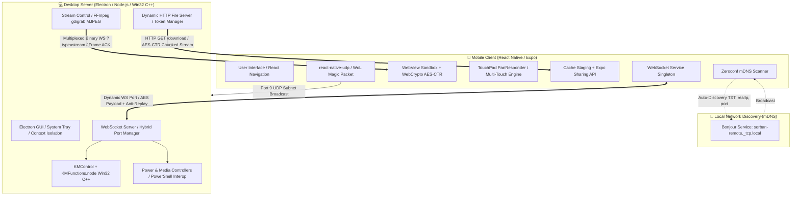

# ⚡ OmniControl — High-Performance Remote Desktop & System Orchestration Suite

A comprehensive remote control and telemetry suite (**Remote Desktop, Peripheral Virtualization & File Orchestration**) engineered for ultra-low latency across local and hybrid networks. The system consists of a **Hybrid Desktop Server (Node.js / Electron / C++ Win32 Native Addon)** and a **Mobile Client (React Native / Expo)**. It delivers real-time screen sharing, hardware-level mouse and keyboard emulation with multi-touch gestures, secure file transfers via encrypted streams, and remote boot capabilities via Wake-on-LAN.

## 🎯 Engineering Highlights

This project addresses real-world challenges in software architecture, networking, and low-level optimization:

* **Zero-Buffer-Bloat Video Pipeline:** Desktop capture via `FFmpeg (gdigrab)` with in-memory binary JPEG frame slicing (`0xFF 0xD8` — `0xFF 0xD9`) and a **Backpressure Flow Control (`FRAME_ACK`)** mechanism. The server emits a new frame only after the client acknowledges the rendering of the previous one, keeping latency under $50\text{ ms}$ even on congested Wi-Fi or Hotspot networks.

* **Hardware-Accelerated Decryption in Sandbox:** To bypass the performance limitations of the React Native JavaScript thread during massive binary processing, the video stream is routed through an isolated `WebView` core. This leverages the **WebCrypto API (`window.crypto.subtle`)** for `AES-256-CTR` decryption directly on the mobile GPU.

* **C++ Native Addon (`node-gyp` & Win32 API):** Mouse, scroll, and keyboard commands completely bypass slow abstractions. They are executed directly within the Windows kernel via native C++ calls (`SendInput`, `SetCursorPos`, `mouse_event`).

* **Resilient Networking & Virtual Adapter Filtering:** The `mDNS (Bonjour / Zeroconf)` auto-discovery system includes an OSI interface inspection algorithm that automatically excludes virtual adapters (VirtualBox, Hyper-V, WSL, VMware, APIPA) and negotiates persistent dynamic ports with automatic fallback on collisions (`EADDRINUSE`).

* **End-to-End (E2E) Cryptographic Architecture:** All communication channels are protected by `AES-256` symmetric encryption, utilizing $16\text{-byte}$ ephemeral Initialization Vectors (IV) generated per-packet/per-frame, a time-windowed **Anti-Replay** protection ($2000\text{ ms}$), and Single-Use Tokens for file downloads.

## 📑 Table of Contents

1. [High-Level System Architecture](#-high-level-system-architecture)
2. [Component 1: Desktop Server (`_nodejs`)](#-component-1-desktop-server-_nodejs)
   * [Technologies & Dependencies](#technologies--dependencies-server)
   * [Graphical User Interface (Electron GUI & System Tray)](#graphical-user-interface-electron-gui--system-tray)
   * [WebSocket Core & Port Management](#websocket-core--port-management)
   * [Native C++ Addon (`KMFunctions.cpp`)](#native-c-addon-kmfunctionscpp)
   * [Screen Streaming Engine (FFmpeg & Flow Control)](#screen-streaming-engine-ffmpeg--flow-control)
   * [Dynamic File Server & Token System](#dynamic-file-server--token-system)
   * [System & Media Control](#system--media-control)
3. [Component 2: Mobile Client (`react-native-app`)](#-component-2-mobile-client-react-native-app)
   * [Technologies & Dependencies](#technologies--dependencies-mobile)
   * [Design System & Customization (Theme & Language Context)](#design-system--customization-theme--language-context)
   * [Automated mDNS Discovery (`react-native-zeroconf`)](#automated-mdns-discovery-react-native-zeroconf)
   * [Screen Share with Hardware-Accelerated WebCrypto](#screen-share-with-hardware-accelerated-webcrypto)
   * [Multi-Touch TouchPad & Virtual Keyboard](#multi-touch-touchpad--virtual-keyboard)
   * [Wake-on-LAN (UDP Magic Packet) & Power Management](#wake-on-lan-udp-magic-packet--power-management)
   * [File Explorer & Stream-based Downloading](#file-explorer--stream-based-downloading)
4. [Security & Communication Protocols](#-security--communication-protocols)
5. [Full Project Structure](#-full-project-structure)
6. [License](#-license)

## 🏛️ High-Level System Architecture

The architecture relies on a Client-Server model operating over the local network (LAN / Wi-Fi), utilizing WebSocket multiplexing and dedicated channels for binary data transfer:



## 💻 Component 1: Desktop Server (`_nodejs`)

### Technologies & Dependencies (Server)

* **Electron**: Runs the application as native desktop software with System Tray integration and secure Context Isolation (`preload.js`).
* **Node.js (v20+) & Node-GYP**: Asynchronous runtime environment and toolchain for compiling native C++ modules (`.node`).
* **ws**: High-performance WebSocket server with multiplexing for JSON commands and binary video streams.
* **bonjour-service**: Publishes the server on the local mDNS network for zero-config pairing.
* **Crypto-JS & Node Crypto**: `AES-256` symmetric encryption for control packets and data streams.
* **@ffmpeg-installer/ffmpeg**: High-performance desktop video capture directly from the Windows graphics subsystem.

### Graphical User Interface (Electron GUI & System Tray)

* **Single Instance Lock**: Prevents multiple instances from running; opening the app again brings the existing window to the foreground.
* **System Tray Lifecycle**: Closing the window `(X)` silently migrates the process to the System Tray for uninterrupted background operation.
* **Dynamic Context Menu**: Displays real-time status (`Online` + active port or `Offline`), configuration options, and a full shutdown trigger.
* **Auto-Startup & Silent Boot**: Windows Registry integration (`app.setLoginItemSettings`) for automatic boot startup, launching directly into the Tray if a valid configuration exists.
* **Customization & Internationalization (i18n)**:
  * Full Dark/Light Mode support with 6 chromatic accent themes.
  * Native multi-language support for **13 languages** in the desktop interface.
  * Real-time visual indicator for the mobile client's session state.

### WebSocket Core & Port Management

Implemented in [`_nodejs/server/websocket.js`](./_nodejs/server/websocket.js) and [`_nodejs/server/PortManager.js`](./_nodejs/server/PortManager.js):

* **Hybrid Port Allocation**:
  * **Auto Mode**: Requests an ephemeral free port from the OS via `listen(0)` and persists it in `%APPDATA%\OmniControl\config.json`, reusing it upon subsequent restarts.
  * **Auto-Healing on Collisions (`EADDRINUSE`)**: If the saved port is occupied by another process, the server transparently negotiates a new port and updates the mDNS broadcast automatically, without user intervention.
  * **Manual Mode**: Allows fixing a specific user-defined port in the $1024 - 65535$ range.
* **Virtual Adapter Filtering (`getPhysicalLanIp`)**:
  * Inspects network interfaces via `os.networkInterfaces()`.
  * Deterministically excludes virtual interfaces (VirtualBox `192.168.56.x`, VMware, Hyper-V, vEthernet, WSL), APIPA addresses (`169.254.x.x`), and Windows ICS (`192.168.137.x`).
  * Publishes the true physical IPv4 address in the `txt.realIp` field of the mDNS packet.
* **Authentication Watchdog & Anti-Replay**:
  * Any new connection must complete the encrypted handshake within a **5-second window** (`handshakeTimeout`), otherwise, the socket is automatically destroyed (`4001 Unauthorized`).
  * Every control packet includes a `timestamp`. Packets deviating by more than $2000\text{ ms}$ from the server's clock are rejected to prevent *Replay Attacks*.

### Native C++ Addon (`KMFunctions.cpp`)

To eliminate latency introduced by external processes, peripheral emulation is written in pure C++ and compiled as a native addon in [`_nodejs/Control/Control/KMFunctions.cpp`](./_nodejs/Control/Control/KMFunctions.cpp):

* **`SetCursorPosition(x, y)`**: Calculates relative displacement and directly calls `GetCursorPos()` and `SetCursorPos()` from the Win32 API.
* **`Scroll(x, y)` & `Zoom(amount)`**: Injects hardware events into the input stack via `mouse_event(MOUSEEVENTF_WHEEL / MOUSEEVENTF_HWHEEL)` combined with the `VK_CONTROL` virtual key state.
* **`MinimizeAllWindows()` / `RestoreAllWindows()`**: Interacts with the desktop window handle (`ShowWindow(GetDesktopWindow(), SW_MINIMIZE / SW_RESTORE)`).
* **`LeftClick()` / `RightClick()`**: Emulates physical presses and releases (`MOUSEEVENTF_LEFTDOWN` / `LEFTUP`), fully supporting complex *Drag & Drop* operations.
* **`SendKeyPress(asciiCode)`**: Uses the `INPUT_KEYBOARD` structure and `SendInput()` with full `KEYEVENTF_UNICODE` support and hardware scan codes for control keys (`0x1C` Enter, `0x0E` Backspace).

### Screen Streaming Engine (FFmpeg & Flow Control)

Implemented in [`_nodejs/Control/StreamControl.js`](./_nodejs/Control/StreamControl.js):

* **Capture & Encoding**: Spawns an `FFmpeg` subprocess connected to `gdigrab` (`-framerate 30`, `-draw_mouse 1`, `-vsync cfr`, `-c:v mjpeg`, `-q:v 5`) with binary output piped to `stdout` (`image2pipe`).
* **In-Memory Binary Frame Parser**:
  * The `stdout` stream is accumulated in a dynamic buffer and scanned for standard JPEG binary delimiters: *Start of Image* (`0xFF, 0xD8`) and *End of Image* (`0xFF, 0xD9`).
  * Incomplete frames or those under the integrity threshold ($5000\text{ bytes}$) are discarded.
* **Lockstep Mechanism (`FRAME_ACK`)**:
  * The server maintains a state semaphore (`isClientReady`) for the stream connection (identified by the `?type=stream` query on the primary WebSocket port).
  * A new frame is encrypted and transmitted *only* after the client's WebView acknowledges rendering the previous frame, preventing TCP buffer saturation on mobile networks.
* **Frame-Level Binary Encryption**:
  * Each extracted JPEG image is encrypted with `AES-256-CTR` using a unique $16\text{-byte}$ IV attached as a binary header: `[16 Bytes IV] + [AES-CTR Encrypted Payload]`.

### Dynamic File Server & Token System

Implemented in [`_nodejs/server/FileServer.js`](./_nodejs/server/FileServer.js) and [`_nodejs/server/TokenManager.js`](./_nodejs/server/TokenManager.js):

* **Asynchronous Exploration (`getFiles.js`)**: Queries mounted partitions via PowerShell (`Get-PSDrive`) and traverses directories non-blocking via `fs.promises.readdir`, hierarchically sorting directories and files.
* **Dynamic HTTP Port Allocation**: The HTTP file server boots on a dynamically OS-allocated port (`listen(0)`), eliminating conflicts with other local services. The active port is transmitted securely to the client over the WebSocket channel.
* **Single-Use Tokens**:
  * Upon a file request, the server issues a $16\text{-byte}$ cryptographic token with a **30-second TTL (Time-To-Live)**.
  * The token is instantly invalidated upon initiating the download (`consumeToken`), blocking any unauthorized URL access attempts.
* **Zero-RAM Encrypted Streaming**: Files are read via `fs.createReadStream`, passed through a `crypto.createCipheriv('aes-256-ctr')` transform stream, and piped directly into the HTTP response. This allows transferring multi-gigabyte files without overloading the host's RAM.

### System & Media Control

* **Power Management ([`_nodejs/Control/PowerControl.js`](./_nodejs/Control/PowerControl.js))**: Native execution for `SHUTDOWN`, `RESTART`, `HIBERNATE`, `SLEEP`, `LOGOUT`, and `LOCK`.
* **Media Control ([`_nodejs/Control/MediaControl.js`](./_nodejs/Control/MediaControl.js))**: C# / PowerShell interop for injecting media virtual keyboard events (`VK_VOLUME_UP`, `VK_VOLUME_DOWN`, `VK_MEDIA_PLAY_PAUSE`, `VK_MEDIA_NEXT_TRACK`, `VK_MEDIA_PREV_TRACK`).

## 📱 Component 2: Mobile Client (`react-native-app`)

### Technologies & Dependencies (Mobile)

* **React Native & Expo SDK**: Cross-platform modular architecture.
* **react-native-zeroconf**: Native mDNS resolution via Android's `NsdManager`.
* **react-native-webview**: Isolated environment for $30\text{ FPS}$ video rendering and WebCrypto execution.
* **react-native-udp**: Raw UDP packet construction and transmission for Wake-on-LAN.
* **expo-file-system & expo-sharing**: Local cache management, stream decryption, and OS-native menu integration for saving and sharing files.

### Design System & Customization (Theme & Language Context)

* **Modern Interface**: Visual architecture based on *Glassmorphism*, dynamic accents (`expo-linear-gradient`), and haptic feedback.
* **Global State Management (`ThemeContext` & `LanguageContext`)**:
  * Instant Dark / Light Mode switching and 6 chromatic palettes.
  * Independently configurable sensitivity multipliers for Cursor, Scroll, and Zoom ($0.1\times - 3.0\times$).
  * Full internationalization supporting **23 languages**.
* **FIFO Queue Alert System (`CustomAlert.js`)**: A modal notification manager that serializes system messages into a *First-In-First-Out* queue, preventing critical errors from overlapping or being lost.

### Automated mDNS Discovery (`react-native-zeroconf`)

Implemented in [`react-native-app/Screens/ComputerScreens/LocalComputersScreen.js`](./react-native-app/Screens/ComputerScreens/LocalComputersScreen.js):

* Handles granular Android 13+ permissions (`NEARBY_WIFI_DEVICES`, `ACCESS_FINE_LOCATION`).
* Runs a continuous $12\text{-second}$ listening window to bypass asynchronous limitations in `NsdManager`.
* **Intelligent IP Resolution**: Prioritizes the validated address from `service.txt.realIp` and applies strict client-side filtering against loopback addresses, IPv6, or virtualization subnets.

### Screen Share with Hardware-Accelerated WebCrypto

Implemented in [`react-native-app/Screens/RemoteScreens/DisplayScreen.js`](./react-native-app/Screens/RemoteScreens/DisplayScreen.js):

* **Local Secure Context (`http://localhost`)**: Initializes the `WebView` within a Chromium-recognized *Secure Context*, unlocking the native `window.crypto.subtle` API while allowing local WebSocket (`ws://`) connections.
* **Zero-Memory-Leak Decryption and Rendering**:
  * Each `ArrayBuffer` packet is unpacked into a $16\text{-byte}$ IV and ciphertext, then hardware-decrypted.
  * The resulting image is mounted in the DOM via `URL.createObjectURL(blob)`, and the previous frame's reference is immediately destroyed via `URL.revokeObjectURL()` to keep memory consumption flat during prolonged sessions.
* **Interactive Viewport & Split Controls**:
  * Supports smooth *Pinch-to-Zoom* and *Panning* via hardware-accelerated 3D CSS transforms (`translate3d`), plus a *Double-Tap* (under $300\text{ ms}$) perspective reset.
  * Below the video feed, a switchable **TouchPad / Keyboard** panel is directly integrated, allowing complete PC control without leaving the stream view.

### Multi-Touch TouchPad & Virtual Keyboard

Implemented in [`react-native-app/Screens/RemoteScreens/KMControl/TouchPad.js`](./react-native-app/Screens/RemoteScreens/KMControl/TouchPad.js) and [`Keyboard.js`](./react-native-app/Screens/RemoteScreens/KMControl/Keyboard.js):

#### Multi-Touch Gesture Matrix (Slot-Based Tracking):

| Gesture | Active Fingers | Executed Server Action | 
| ----- | ----- | ----- | 
| **Continuous drag** | 1 | Relative cursor movement scaled by the sensitivity multiplier | 
| **Short Tap (**$< 400\text{ ms}$**)** | 1 | **Left Click** | 
| **Vertical / Horizontal drag** | 2 | Native vertical or horizontal **Scroll** | 
| **Pinch In / Pinch Out** | 2 | **Zoom In / Zoom Out** (`CTRL` + Scroll) | 
| **Short Tap (**$< 400\text{ ms}$**)** | 2 | **Right Click** | 
| **Swipe Up** | 3 | **Restore All Windows** | 
| **Swipe Down** | 3 | **Show Desktop / Minimize All Windows** | 
| **Short Tap** | 3 | **Drag & Drop Lock/Unlock** (toggles continuous Left Click state) | 

#### Advanced Virtual Keyboard:

* Real-time transmission for Unicode/ASCII characters, system keys (`WIN`, `CTRL`, `SHIFT`, `ALT`, `TAB`, `ESC`, `INS`, `DEL`, `HOME`, `END`), function keys (`F1`–`F12`), and a macro builder for complex shortcuts (e.g., `CTRL + SHIFT + ESC`, `ALT + F4`).

### Wake-on-LAN (UDP Magic Packet) & Power Management

Implemented in [`react-native-app/Screens/RemoteScreens/PowerScreen.js`](./react-native-app/Screens/RemoteScreens/PowerScreen.js):

* **Binary Magic Packet Generator**: Constructs the standard IEEE $102\text{-byte}$ packet from the server's MAC address:
  
  $$
  \text{Magic Packet} = \underbrace{[0\text{xFF} \times 6]}_{6\text{ bytes sync}} + \underbrace{[\text{MAC Address} \times 16]}_{96\text{ bytes payload}}
  $$

* **UDP Broadcast**: Transmits the datagram via `react-native-udp` on port `9` to wake the Network Interface Controller (NIC) from low-power states (S3 / S5 / Modern Standby).

### File Explorer & Stream-based Downloading

Implemented in [`react-native-app/Screens/RemoteScreens/File/FileScreen.js`](./react-native-app/Screens/RemoteScreens/File/FileScreen.js) and [`FileDownload.js`](./react-native-app/Screens/RemoteScreens/File/FileDownload.js):

1. **Dynamic Negotiation**: The client requests a download over the WebSocket, receiving the Single-Use Token and the active HTTP port of the file server.
2. **Iterative On-Disk Decryption**:
   * The encrypted stream is downloaded to the application's temporary cache directory.
   * The first $16\text{ bytes}$ (IV) are extracted, initializing a progressive `CryptoJS.algo.AES.createDecryptor` in `CTR` mode (`NoPadding`), processing the file in chunks to avoid locking memory on mobile devices.
3. **Native Saving (`expo-sharing`)**: Following successful decryption and integrity checks, the app invokes the Android/iOS native OS intent interface. This allows the user to save the file in any local directory (*Downloads*, *Documents*), upload it to the Cloud, or share it directly with other applications.

## 🔒 Security & Communication Protocols

| Channel / Protocol | Architectural Role | Security & Validation Mechanism | 
| ----- | ----- | ----- | 
| **mDNS (Zeroconf)** | LAN auto-discovery (`serban-remote._tcp.local`) | TXT metadata with virtual interface filtering | 
| **WebSocket (Control)** | Persistent dynamic port, JSON commands | **AES-256** + Anti-Replay window ($< 2000\text{ ms}$) + Handshake Timeout ($5\text{ s}$) | 
| **WebSocket (Video)** | Multiplexed (`?type=stream`), MJPEG binary frames | **AES-256-CTR** with random $16\text{-byte}$ IV generated per frame | 
| **HTTP File Server** | Dynamic port, `/download` route | Cryptographic Single-Use Token ($30\text{s}$ TTL) + **AES-256-CTR** stream | 
| **UDP Broadcast** | Port 9, Wake-on-LAN | Binary Magic Packet ($102\text{ bytes}$) | 

## 📂 Full Project Structure

```
./
├── .gitignore                          # Git exclusion rules (node_modules, compiled binaries, config)
├── README.md                           # Technical architecture documentation
│
├── _nodejs/                            # DESKTOP SERVER (Electron / Node.js / Win32 C++)
│   ├── package.json                    # Server dependencies and build scripts
│   ├── binding.gyp                     # node-gyp configuration for C++ addon compilation
│   ├── server.js                       # Backend logic entry point
│   │
│   ├── GUI/                            # Desktop Graphical Interface (Electron)
│   │   ├── main.js                     # Main process, System Tray, Single Instance Lock
│   │   ├── preload.js                  # Secure IPC bridge (Context Isolation)
│   │   ├── renderer.js                 # UI logic, themes, password validation, i18n
│   │   ├── index.html                  # Control panel structural HTML
│   │   └── translations.js             # i18n dictionary (13 languages)
│   │
│   ├── server/                         # Networking and Security Subsystem
│   │   ├── websocket.js                # WebSocket server, mDNS Bonjour, authentication
│   │   ├── sendMessage.js              # AES encryption engine and packet routing
│   │   ├── PortManager.js              # Hybrid port management and auto-healing
│   │   ├── TokenManager.js             # Ephemeral token generator (Single-Use Tokens)
│   │   └── FileServer.js               # Dynamic HTTP server for encrypted file streaming
│   │
│   └── Control/                        # Hardware and System Controllers
│       ├── StreamControl.js            # FFmpeg gdigrab pipeline, JPEG parser, Flow Control ACK
│       ├── PowerControl.js             # Windows power states management
│       ├── MediaControl.js             # Multimedia control via PowerShell / Win32 Interop
│       ├── File/
│       │   ├── FileControl.js          # File explorer orchestration and download requests
│       │   └── getFiles.js             # Asynchronous querying of partitions and directories
│       └── Control/
│           ├── KMControl.js            # Interface between the WebSocket router and C++ module
│           └── KMFunctions.cpp         # Win32 C++ native addon (SendInput, SetCursorPos)
│
└── react-native-app/                   # MOBILE CLIENT (React Native / Expo)
    ├── package.json                    # Mobile client dependencies
    ├── app.json                        # Expo manifest and native Android/iOS permissions
    ├── App.js                          # App root, navigation stack, and providers
    ├── ThemeContext.js                 # Global state for themes and sensitivity curves
    ├── LanguageContext.js              # Global state for internationalization
    ├── translations.js                 # Full dictionary (23 languages)
    │
    └── Screens/                        # Client Screens and Services
        ├── HomeScreen.js               # Main dashboard and connection telemetry
        ├── SettingsScreen.js           # Theme, language, and TouchPad parameter configuration
        ├── CustomAlert.js              # FIFO queue modal alert system
        ├── WebSocket.js                # WebSocket Singleton service and client cryptography
        │
        ├── ComputerScreen.js           # Saved server profiles management
        ├── ComputerScreens/
        │   ├── AddComputerScreen.js    # Manual add/edit with IP, Port, and MAC validation
        │   ├── LocalComputersScreen.js # mDNS Zeroconf scanner with subnet filtering
        │   └── ComputerManager.js      # Configuration persistence in local storage
        │
        ├── RemoteScreen.js             # Central hub for control modules
        └── RemoteScreens/
            ├── DisplayScreen.js        # MJPEG video player with WebCrypto AES-CTR and split-controls
            ├── PowerScreen.js          # Power commands and Wake-on-LAN UDP emitter
            ├── MediaScreen.js          # Multimedia remote control
            ├── KMControl/
            │   ├── KMControlScreen.js  # Dedicated TouchPad + Keyboard view
            │   ├── TouchPad.js         # Multi-touch gesture engine (1, 2, and 3 fingers)
            │   └── Keyboard.js         # Full virtual keyboard and system macros
            └── File/
                ├── FileScreen.js       # Remote file explorer interface
                ├── FileList.js         # Optimized rendering of the directory tree
                └── FileDownload.js     # HTTP client with stream AES decryption and native sharing
```

## 📄 License

This project is distributed under the **MIT** License. See the `LICENSE` file for full details.